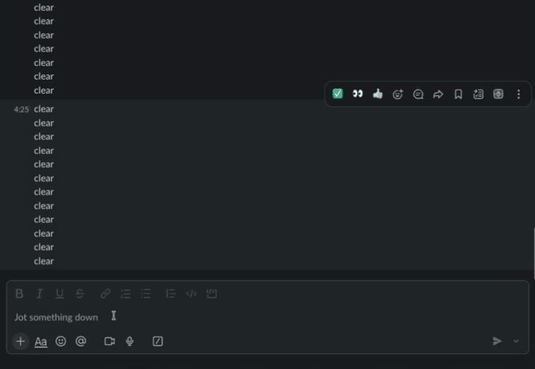
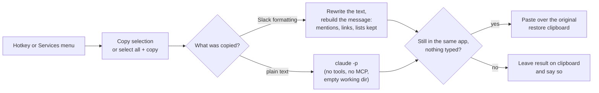

<div align="center">


# Refine Anywhere

**Select text in any Mac app, press a hotkey, and get a clearer, tighter version back in place.** ✨

Built for Slack's desktop app, which has no "rewrite my message" button. It keeps your formatting, @mentions and links intact.


</div>

<p align="center">
  
</p>

<p align="center"><em>The right-click → Services → Refine using AI route, then the <code>Cmd+Shift+2</code> hotkey (recorded with the first, plain-text version). Full-quality video: <a href="docs/demo.mp4">docs/demo.mp4</a>.</em></p>

---

## 🪄 What it does

You write a message. You press `Cmd+Shift+2`. The text in the box is replaced with a better version, and **you** read it and press Enter. Nothing is ever sent for you.

| Before | After |
| --- | --- |
| *me and him goes to store yesterday* | *He and I went to the store yesterday.* |
| *The Friday retro invite (Team Retro), can we add a link to the board? its kind of hard to find where we keep it..* | *Could we add the board link to the Friday Team Retro invite? It's hard to find right now.* |

## ✨ Features

### 🧠 Refining
- ✍️ **A real rewrite, not just a spellcheck.** It fixes typos and grammar, leads with the point, cuts filler and tightens list items, in a natural, conversational tone.
- 🎚️ **Two styles.** `full` (default) rewrites for clarity and brevity. `light` only fixes typos, grammar and punctuation.
- 🧾 **Keeps what matters.** Names, titles, dates, numbers and the "who did what" survive. Emoji, @mentions, #channels, links and code are kept exactly as written.
- 🚫 **Never an em dash.** Forbidden in the prompt and enforced again in code.
- 🤖 **Choose your model.** Sonnet by default, Haiku if you want speed.

### 💬 Slack, done properly
- 🎨 **Formatting survives.** Bold, italic, links, bullet and numbered lists, @mentions and smart links go through the round trip.
- 🔒 **Mentions and links are locked.** They must come back exactly once and in order, or the rewrite is rejected.
- 📋 **Lists are rebuilt**, so items can be reworded and reordered and the numbering stays right.

### ⚡ Feels native
- ⌨️ **Global hotkey** `Cmd+Shift+2` through Karabiner-Elements, plus a **right-click → Services → Refine using AI** menu item.
- 🫧 **Instant feedback:** a floating "Refining…" pill and a soft sound appear in a fraction of a second, then a short "✓ Refined".
- 🎯 **Refines the selection**, or the whole field if nothing is selected.
- 🌍 **Works in any app** with a text field. Formatting is preserved in Slack; other apps get plain text (or HTML where the app provides it).

### 🛟 Safe by design
- 🧯 **Your text is never lost.** If Claude fails or times out, your original is left untouched.
- 🪟 **Never pastes into the wrong window.** Switch apps while it works and the result waits on your clipboard instead.
- ⌨️ **Never pastes over what you typed.** Type or click mid-refine and it keeps out of the way, with the result on your clipboard.
- 🩹 **Self-healing sign-in.** If Claude is signed out, a pill says so, the browser login opens, and you get told to press the hotkey again. If that doesn't finish, a dialog explains the fix and copies the command for you.
- 🔁 **Smart fallbacks.** A rewrite that can't be applied faithfully is retried once with the lighter style. If that fails too, nothing is pasted and the text stays on your clipboard.

### 🔐 Private
- Your text goes to Anthropic through the `claude` CLI with **your own login**. The CLI runs with no tools, no MCP servers and no settings, from an empty directory. Nothing else is read or sent.

## 🚀 Install

```bash
git clone git@github.com:RuneStone0/refine-anywhere.git
cd refine-anywhere
./install.sh
```

Then, once:

1. 🔑 **Log in to Claude** in your own terminal: `claude auth login`.
2. ⌨️ **Enable the hotkey:** Karabiner-Elements → Complex Modifications → Add predefined rule → *Refine Anywhere*.
3. 🛡️ **Allow Accessibility** (needed so the script can send Cmd+C / Cmd+V). In System Settings → Privacy & Security → Accessibility, add:
   `/Library/Application Support/org.pqrs/Karabiner-Elements/Karabiner-Console-User-Server.app`
   then restart it so the permission takes effect:
   ```bash
   launchctl kickstart -k gui/$(id -u)/org.pqrs.service.agent.Karabiner-Console-User-Server
   ```
4. 🖱️ **Services menu:** if you don't see *Refine using AI*, tick it under System Settings → Keyboard → Keyboard Shortcuts → Services → Text.

**Requirements:** macOS · [Claude Code](https://docs.claude.com/en/docs/claude-code) installed and signed in · Xcode Command Line Tools (`xcode-select --install`, used to build the two helpers) · [Karabiner-Elements](https://karabiner-elements.pqrs.org/) for the hotkey (the Services item works without it).

Uninstall with `./uninstall.sh`.

## 🎮 Usage

- Select text and press **`Cmd+Shift+2`**. With nothing selected, the whole text field is refined.
- Or select text, right-click, **Services → Refine using AI**.
- It takes about 3 to 8 seconds depending on the model and message length. Stay in the app until it finishes.

## ⚙️ Configuration

Karabiner and Services don't pass your shell environment, so settings are plain files under `~/.config/refine-anywhere/`:

| File | Effect |
| --- | --- |
| `model` | Model alias or id. Default `sonnet`. `haiku` is faster but less consistent around awkward text. |
| `style` | `full` (default): rewrite for clarity and brevity, keeping meaning, facts, names and stance. `light`: minimal edits, only typos, grammar, punctuation and capitalisation. |
| `prompt.txt` | Replaces the system prompt for either style, e.g. to change tone. Keep the `<draft></draft>` instructions so drafts that read like requests are edited, not answered. With a custom prompt there is no automatic retry with the light style. The "never an em dash" rule is also enforced in code. |
| `oauth-token` | Optional: the token printed by `claude setup-token` (long-lived, independent of the keychain session that expires). Exported as `CLAUDE_CODE_OAUTH_TOKEN` for the `claude` calls. Not covered by tests. |
| `no-hud` | Empty file: use notifications instead of the floating pill. |
| `no-sound` | Empty file: no start/finish sounds. |
| `debug` | Empty file: log timings and decisions (never your text) to `~/Library/Logs/refine-anywhere.log`. Delete it to stop logging. |
| `no-paste` | Empty file, for diagnostics: do everything except paste, leaving the result on the clipboard. |

To change the hotkey, edit the rule in `karabiner/refine-anywhere.json` (or in Karabiner's own UI).

For scripting and tests the scripts also read `REFINE_MODEL`, `REFINE_STYLE` and `REFINE_CLAUDE` (a stand-in for the `claude` binary) from the environment.

## 🔧 How it works



| Piece | Role |
| --- | --- |
| `bin/refine-text` | Reads text on stdin, calls the [Claude Code](https://docs.claude.com/en/docs/claude-code) CLI in print mode with an editing prompt, validates the result, prints it. On any error it prints your **original text unchanged**. |
| `bin/refine-selection` | The hotkey wrapper: copy, refine, paste, restore your clipboard, with the safety checks above. |
| `tools/refine-clip.swift` | Small native helper: key presses, clipboard access, frontmost-app lookup, and the Slack rich-text logic. Replaces `osascript` calls that each cost 0.2 to 0.4 s. |
| `tools/refine-hud.swift` | The floating progress pill. |
| `services/Refine using AI.workflow` | An Automator Quick Action (Run Shell Script, text in, text out). |
| `karabiner/refine-anywhere.json` | An importable Karabiner rule that binds `Cmd+Shift+2` to `refine-selection`. |

### 💬 Slack rich text

When you copy formatted text in Slack, the clipboard holds a Chromium "web custom data" blob with a `slack/texty` entry: a list of text runs, each with attributes (`{"insert":"bold","attributes":{"bold":true}}`). `refine-clip` reads it and applies the refinement in one of two ways:

- **Rebuild (default `full` style, free rewrites).** The model sees the text with list items written as `1. ` / `- ` lines and rewrites it freely: merging sentences, rewording and reordering list items. `refine-clip rebuild` then reconstructs the message. Mentions and smart links are protected tokens that must come back exactly once and in order, lists are rebuilt from the line prefixes, and bold, italic and links are re-applied wherever their words survive. A rewrite that drops a mention or a link is rejected.
- **Diff (`light` style, small edits).** The model sees plain text. Its answer is diffed word by word against the original and each change is applied only **inside the single editable run it belongs to**. A rewrite that cannot be reproduced exactly is rejected.

Either way the result is verified (protected runs, links and URLs unchanged), then the clipboard is rewritten (clear, then every format back, since macOS silently ignores in-place edits to another app's clipboard) and pasted. If anything doesn't check out it retries with the light style and otherwise stops without pasting, rather than risk mangling the message. Other apps' HTML (e.g. browsers) takes a similar path with a tag-structure check; that path has had far less real-world testing than Slack's.

## 🩺 Troubleshooting (lessons learned)

- **Everything fails with a sign-in message:** Claude is signed out. The tool tries `claude auth login` itself; if that is not possible, run it in a terminal. Check with `claude auth status`.
- **Nothing happens and the debug log says `trusted=false`:** grant Accessibility to `Karabiner-Console-User-Server.app` (not just Karabiner-Elements) and restart it with the `launchctl kickstart` command above.
- **Text is copied and refined but never pasted:** key events posted by a process that exits immediately can be dropped by macOS. `refine-clip key` therefore stays alive briefly after posting. If you wrap it, keep that.
- **"Not logged in" only when run from Karabiner/Services:** `claude` needs `USER`, `LOGNAME` and `TMPDIR` to reach your keychain login. The scripts set them if missing.
- **20 to 45 s instead of about 4 s:** Karabiner-started processes can run at background priority, `claude` is slow in a large working directory, and extended thinking adds seconds. The scripts clear the background priority, run from an empty directory and set `MAX_THINKING_TOKENS=0`.
- **Services item runs but the text isn't replaced:** the workflow must not be bound to an app (no `serviceApplicationBundleID` in `document.wflow`), or macOS treats it as Finder-only.
- **The model answers your message instead of editing it:** drafts are wrapped in `<draft>` tags and the prompt says to edit, never answer. A custom `prompt.txt` should keep that.
- **It rewrote more than I wanted:** set `style` to `light` for typo-and-grammar fixes only.
- **A formatted message took about 8 s or nothing was pasted:** the full rewrite dropped or moved a mention or link, so it was rejected. It retries with the light style, and if that can't be applied safely either, the refined text is left on the clipboard instead.

## 🚧 Limitations

- Formatting is preserved in Slack only. Other apps are refined as plain text (or HTML where the app provides it).
- In a full rewrite, bold, italic and strike survive only where the formatted words are kept verbatim. Links are never lost. Messages with quotes, code blocks, headings, checklists or images use the light style instead.
- The Services menu item always works on plain text.
- The hotkey temporarily uses your clipboard (restored afterwards, plain text only).
- Requires apps that respond to Cmd+C / Cmd+V / Cmd+A in their text fields.
- Slack can change its clipboard format at any time. If rich-text mode ever stops working it falls back to plain text.
- Your text is sent to an LLM. Don't use it on content your organisation doesn't allow you to send to one.

## 📄 License

[MIT](LICENSE). Made for people who write a lot of Slack messages and want them to read well. 💜
