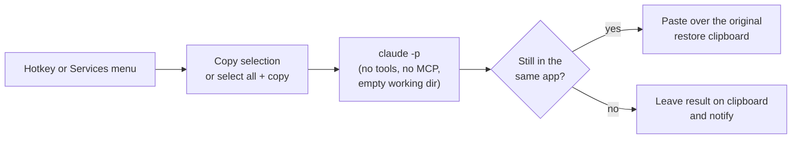

# refine-anywhere

Select text in **any macOS app**, press a hotkey (or right-click → Services), and an LLM rewrites it in place: grammar fixed, wording tightened, tone and meaning kept.

Built for the Slack desktop app, which has no "rewrite my message" button, but it works anywhere text can be copied and pasted.


*Left to right in time: the right-click → Services → Refine using AI route, then the `Cmd+Shift+2` hotkey. Full-quality video: [docs/demo.mp4](docs/demo.mp4).*

## The problem

I write a lot of Slack messages and I want a quick polish pass before hitting Send: fix the typos, cut the rambling, keep it sounding like me. Microsoft Teams has this built in ("Rewrite with Copilot"). Slack doesn't have a button for it in the composer, and the desktop app can't be extended with a supported plugin. Copy-pasting into a chat window and back breaks the flow.

## What it does

Two ways to trigger the same thing:

| Trigger | How | Works in |
| --- | --- | --- |
| **Hotkey** `Cmd+Shift+2` | Karabiner-Elements runs a script that copies your selection (or the whole field if nothing is selected), refines it, and pastes it back | Any app with a text field |
| **Right-click → Services → Refine using AI** | A macOS Quick Action | Apps that expose the Services menu (native apps, and Slack's desktop app does) |

Nothing is ever sent for you. The refined text replaces your draft; you read it and press Enter yourself.

## How it works



- `bin/refine-text` reads text on stdin, calls the [Claude Code](https://docs.claude.com/en/docs/claude-code) CLI in print mode with a rewrite prompt, and prints the result. On any error or timeout it prints your **original text unchanged**, so you can't lose a draft.
- `bin/refine-selection` is the hotkey wrapper. It saves your clipboard, copies the selection, calls `refine-text`, pastes the result with a synthetic Cmd+V, and restores your clipboard. If you switch apps while it is working, it does not paste into the wrong window; the result is left on the clipboard instead.
- `services/Refine using AI.workflow` is an Automator Quick Action (Run Shell Script, text in, text out) that pipes the selected text through `refine-text`.
- `karabiner/refine-anywhere.json` is an importable Karabiner rule that binds `Cmd+Shift+2` to `refine-selection`.

It reuses your existing `claude` login, so there is no API key to store.

## Requirements

- macOS (developed on macOS 26)
- [Claude Code](https://docs.claude.com/en/docs/claude-code) installed and logged in (`claude /login`)
- [Karabiner-Elements](https://karabiner-elements.pqrs.org/) for the hotkey (the Services menu item works without it)

## Install

```bash
git clone git@github.com:RuneStone0/refine-anywhere.git
cd refine-anywhere
./install.sh
```

Then, once:

1. **Log in to Claude** in your own terminal: `claude /login`.
2. **Enable the hotkey**: Karabiner-Elements → Complex Modifications → Add predefined rule → *Refine Anywhere*.
3. **Allow Accessibility** (needed so the script can send Cmd+C / Cmd+V). In System Settings → Privacy & Security → Accessibility, add:
   `/Library/Application Support/org.pqrs/Karabiner-Elements/Karabiner-Console-User-Server.app`
   then restart it so the permission takes effect:
   ```bash
   launchctl kickstart -k gui/$(id -u)/org.pqrs.service.agent.Karabiner-Console-User-Server
   ```
4. **Services menu**: if you don't see *Refine using AI*, tick it under System Settings → Keyboard → Keyboard Shortcuts → Services → Text.

Uninstall with `./uninstall.sh`.

## Usage

- Select text and press `Cmd+Shift+2`. With nothing selected, the whole text field is refined.
- Or select text, right-click, **Services → Refine using AI**.
- It takes roughly 3–6 seconds with the default model. A notification says "Refining…". Stay in the app until it finishes.

## Configuration

Karabiner and Services don't pass your shell environment, so settings live in files under `~/.config/refine-anywhere/`:

| File | Effect |
| --- | --- |
| `model` | Model alias or id, e.g. `sonnet`. Default: `haiku` (fast). |
| `prompt.txt` | Replaces the default system prompt, e.g. to change tone ("make it more concise and direct"). |
| `debug` | If this file exists, timings and lengths are logged to `~/Library/Logs/refine-anywhere.log`. The log never contains your text. Delete the file to turn logging off. |

To change the hotkey, edit the rule in `karabiner/refine-anywhere.json` (or in Karabiner's own UI).

## Privacy

Your text is sent to Anthropic through the `claude` CLI, using your own login. The CLI is run with tools disabled, no settings or MCP servers, and from an empty temporary directory, so nothing else is read or sent. Don't use it on content your organisation doesn't allow you to send to an LLM.

## Troubleshooting (lessons learned)

- **Nothing happens, log says `accessibility_trusted=false`**: grant Accessibility to `Karabiner-Console-User-Server.app` (not just Karabiner-Elements) and restart it with the `launchctl kickstart` command above.
- **"Not logged in" only when run from Karabiner/Services**: `claude` needs `USER`, `LOGNAME` and `TMPDIR` to reach your keychain login. The scripts set them if missing; if you wrap them in your own script, keep that.
- **Takes 20–30 s instead of ~5 s**: processes started by Karabiner can run at background priority and `claude` is slow in a large working directory. The scripts clear the background priority and run `claude` from an empty directory.
- **Services item runs but the text isn't replaced**: the workflow must not be bound to an app (no `serviceApplicationBundleID` in `document.wflow`), or macOS treats it as Finder-only.
- **Slack's Cmd+C copies nothing**: events are posted straight to the HID tap; make sure no modifier keys are still held. The script waits for them to be released.

## Limitations

- Works on plain text. Rich formatting in the field may be flattened by the copy/paste round trip.
- The hotkey temporarily uses your clipboard (it is restored afterwards, plain text only).
- Requires apps that respond to Cmd+C / Cmd+V / Cmd+A in their text fields.

## License

MIT
