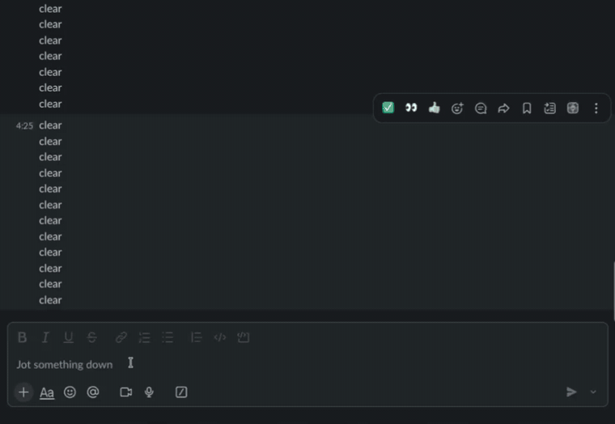
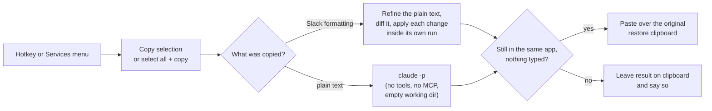

# refine-anywhere

Select text in **any macOS app**, press a hotkey (or right-click → Services), and Claude copy-edits it in place: typos, grammar, punctuation and capitalisation fixed, your wording and tone kept.

Built for the Slack desktop app, which has no "rewrite my message" button. In Slack it **keeps your formatting**: bold, italic, links, lists, @mentions and smart links survive the round trip. In other apps it works on plain text.



*The right-click → Services → Refine using AI route, then the `Cmd+Shift+2` hotkey (recorded with the first, plain-text version). Full-quality video: [docs/demo.mp4](docs/demo.mp4).*

## The problem

I write a lot of Slack messages and I want a quick polish pass before hitting Send: fix the typos, keep it sounding like me. Microsoft Teams has this built in ("Rewrite with Copilot"). Slack has no button for it in the composer, and the desktop app can't be extended with a supported plugin. Copy-pasting into a chat window and back breaks the flow.

## What it does

Two ways to trigger the same thing:

| Trigger | How | Works in |
| --- | --- | --- |
| **Hotkey** `Cmd+Shift+2` | Karabiner-Elements runs a script that copies your selection (or the whole field if nothing is selected), refines it, and pastes it back | Any app with a text field. Formatting is preserved in Slack |
| **Right-click → Services → Refine using AI** | A macOS Quick Action | Apps that expose the Services menu (native apps, and Slack's desktop app does). Plain text only |

While it works you get a small floating **"Refining…"** pill and a soft sound, then a brief "✓ Refined". Nothing is ever sent for you: the refined text replaces your draft, you read it and press Enter yourself.

Safety nets:

- If Claude fails or times out, your original text is left untouched.
- If you switch apps while it works, it does **not** paste into the wrong window. The result is left on the clipboard instead.
- If you type or click while it works, it doesn't paste over what you did. Same fallback.
- Slack mentions and smart links are never reworded, and any change that would damage the formatting is dropped.

## How it works



- `bin/refine-text` reads text on stdin, calls the [Claude Code](https://docs.claude.com/en/docs/claude-code) CLI in print mode with a copy-edit prompt, and prints the result. On any error or timeout it prints your **original text unchanged**.
- `bin/refine-selection` is the hotkey wrapper: copy, refine, paste, restore your clipboard, with the safety checks above.
- `tools/refine-clip.swift` is a small native helper: key presses, clipboard access, frontmost-app lookup, and the Slack rich-text logic. It replaces `osascript` calls that each cost 0.2–0.4 s.
- `tools/refine-hud.swift` is the floating progress pill.
- `services/Refine using AI.workflow` is an Automator Quick Action (Run Shell Script, text in, text out).
- `karabiner/refine-anywhere.json` is an importable Karabiner rule that binds `Cmd+Shift+2` to `refine-selection`.

### Slack rich text

When you copy formatted text in Slack, the clipboard holds a Chromium "web custom data" blob with a `slack/texty` entry: a list of text runs, each with attributes (`{"insert":"bold","attributes":{"bold":true}}`). `refine-clip` reads it and:

1. gives the model only the plain text of the runs, which keeps it as fast and reliable as plain text;
2. diffs the model's answer against the original word by word, and applies each change only **inside the single editable run it belongs to**;
3. never touches runs with `slack*` attributes (mentions, smart links, emoji), URLs, or line-format runs such as bullets;
4. verifies the result has the same runs and attributes, then rewrites the clipboard (clear, then every format back, since macOS silently ignores in-place edits to another app's clipboard) and pastes.

If anything doesn't check out it falls back to plain text rather than risk mangling the message. Other apps' HTML (e.g. browsers) takes a similar path with a tag-structure check; that path has had far less real-world testing than Slack's.

## Requirements

- macOS (developed on macOS 26)
- [Claude Code](https://docs.claude.com/en/docs/claude-code) installed and logged in (`claude /login`)
- Xcode Command Line Tools (`xcode-select --install`), used to build the two helpers
- [Karabiner-Elements](https://karabiner-elements.pqrs.org/) for the hotkey (the Services menu item works without it)

## Install

```bash
git clone git@github.com:RuneStone0/refine-anywhere.git
cd refine-anywhere
./install.sh
```

Then, once:

1. **Log in to Claude** in your own terminal: `claude /login`.
2. **Enable the hotkey**: Karabiner-Elements → Complex Modifications → Add predefined rule → *Refine Anywhere*.
3. **Allow Accessibility** (needed so the script can send Cmd+C / Cmd+V). In System Settings → Privacy & Security → Accessibility, add:
   `/Library/Application Support/org.pqrs/Karabiner-Elements/Karabiner-Console-User-Server.app`
   then restart it so the permission takes effect:
   ```bash
   launchctl kickstart -k gui/$(id -u)/org.pqrs.service.agent.Karabiner-Console-User-Server
   ```
4. **Services menu**: if you don't see *Refine using AI*, tick it under System Settings → Keyboard → Keyboard Shortcuts → Services → Text.

Uninstall with `./uninstall.sh`.

## Usage

- Select text and press `Cmd+Shift+2`. With nothing selected, the whole text field is refined.
- Or select text, right-click, **Services → Refine using AI**.
- It takes about 3–8 seconds depending on the model and message length. The pill shows while it works; stay in the app until it finishes.

## Configuration

Karabiner and Services don't pass your shell environment, so settings are files under `~/.config/refine-anywhere/`:

| File | Effect |
| --- | --- |
| `model` | Model alias or id. Default: `sonnet`. `haiku` is faster but less consistent around awkward text. |
| `prompt.txt` | Replaces the default system prompt, e.g. to change tone ("make it more concise and direct"). Keep the `<draft></draft>` instructions so drafts that read like requests are edited, not answered. |
| `no-hud` | Empty file: use notifications instead of the floating pill. |
| `no-sound` | Empty file: no start/finish sounds. |
| `debug` | Empty file: log timings and decisions (never your text) to `~/Library/Logs/refine-anywhere.log`. Delete it to stop logging. |
| `no-paste` | Empty file, for diagnostics: do everything except paste, leaving the result on the clipboard. |

To change the hotkey, edit the rule in `karabiner/refine-anywhere.json` (or in Karabiner's own UI).

## Privacy

Your text is sent to Anthropic through the `claude` CLI, using your own login. The CLI runs with tools disabled, no settings or MCP servers, and from an empty temporary directory, so nothing else is read or sent. Don't use it on content your organisation doesn't allow you to send to an LLM.

## Troubleshooting (lessons learned)

- **Nothing happens and the debug log says `trusted=false`**: grant Accessibility to `Karabiner-Console-User-Server.app` (not just Karabiner-Elements) and restart it with the `launchctl kickstart` command above.
- **Text is copied and refined but never pasted**: key events posted by a process that exits immediately can be dropped by macOS. `refine-clip key` therefore stays alive briefly after posting. If you wrap it, keep that.
- **"Not logged in" only when run from Karabiner/Services**: `claude` needs `USER`, `LOGNAME` and `TMPDIR` to reach your keychain login. The scripts set them if missing.
- **20–45 s instead of ~4 s**: Karabiner-started processes can run at background priority, `claude` is slow in a large working directory, and extended thinking adds seconds. The scripts clear the background priority, run from an empty directory and set `MAX_THINKING_TOKENS=0`.
- **Services item runs but the text isn't replaced**: the workflow must not be bound to an app (no `serviceApplicationBundleID` in `document.wflow`), or macOS treats it as Finder-only.
- **The model answers your message instead of editing it**: drafts are wrapped in `<draft>` tags and the prompt says to edit, never answer. A custom `prompt.txt` should keep that.
- **Typos fixed but the sentence got reworded**: the default prompt asks for minimal edits; larger models follow it more consistently (hence `sonnet`).

## Limitations

- Formatting is preserved in Slack only. Other apps are refined as plain text (or HTML where the app provides it).
- The Services menu item always works on plain text.
- The hotkey temporarily uses your clipboard (restored afterwards, plain text only).
- Requires apps that respond to Cmd+C / Cmd+V / Cmd+A in their text fields.
- Slack can change its clipboard format at any time; if rich-text mode ever stops working it falls back to plain text.

## License

MIT
